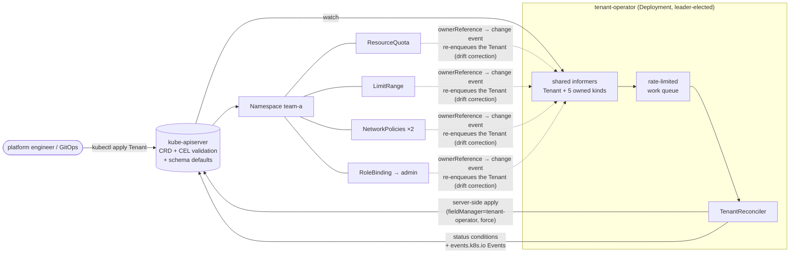
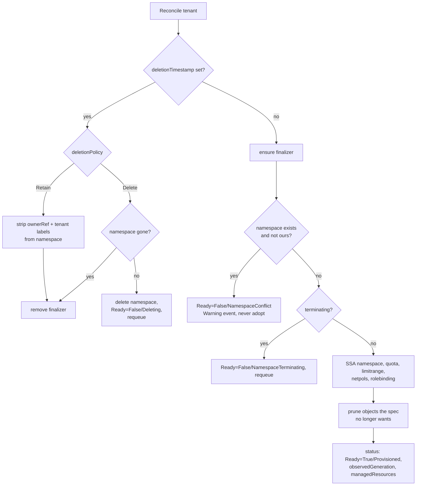

# k8s-operator · tenant-operator

[](https://github.com/HOFFMAN-ALTERNATIVE/k8s-operator/actions/workflows/ci.yml)


[](LICENSE)

A production-shaped **Kubernetes operator** (Go, controller-runtime v0.25,
kubebuilder layout) for **namespace-as-a-service multi-tenancy**. Platform
teams declare a `Tenant`; the operator provisions and *keeps* an isolated,
quota-bounded namespace for it:

```yaml
apiVersion: tenancy.hoffman-alternative.io/v1alpha1
kind: Tenant
metadata:
  name: team-a
spec:
  admins: [{kind: Group, name: team-a-admins}]
  quota: {requests.cpu: "4", requests.memory: 8Gi, pods: "50"}
  defaultLimits:
    requests: {cpu: 100m, memory: 128Mi}
    limits:   {cpu: 500m, memory: 512Mi}
  podSecurity: restricted     # default
  networkIsolation: true      # default
  deletionPolicy: Delete      # or Retain
```

```console
$ kubectl get tenants
NAME     NAMESPACE   READY   REASON        AGE
team-a   team-a      True    Provisioned   12s
```

| Managed object | Purpose |
|---|---|
| `Namespace` | Pod Security Admission labels (`enforce`/`audit`/`warn`), tenant label, controller owner reference |
| `ResourceQuota/tenant-quota` | hard caps from `spec.quota` |
| `LimitRange/tenant-defaults` | default requests/limits so quota-bound namespaces accept pods without explicit resources |
| `NetworkPolicy/default-deny-ingress` + `allow-same-namespace` | east-west isolation between tenants |
| `RoleBinding/tenant-admins` | `spec.admins` → built-in `admin` ClusterRole, scoped to the namespace |

## Architecture



### Reconcile loop



## Design decisions

- **Level-triggered and idempotent.** Each reconcile recomputes the *entire*
  desired state from the spec and applies it — no diffing of "what changed",
  so missed or coalesced events can't leave things half-done.
- **Server-side apply with typed apply configurations** (`client.Apply` +
  `k8s.io/client-go/applyconfigurations`) instead of `CreateOrUpdate`. No
  read-modify-write races, no `resourceVersion` conflicts, and field
  ownership is tracked by the API server under the `tenant-operator` manager.
  `ForceOwnership` means the operator wins conflicts on the fields it
  declares — which is exactly what makes **drift correction** work: a hand
  edit to the quota triggers a watch event (owner reference), and the next
  apply puts it back.
- **Owner references + a finalizer, for different reasons.** Owner refs give
  watch fan-in and garbage collection. The finalizer exists because GC alone
  can't express policy: with `Retain` the operator must release ownership
  *before* GC acts; with `Delete` the Tenant stays (Ready=False/Deleting)
  until the namespace is really gone, so re-creating a tenant of the same
  name can't race a terminating namespace.
- **Never adopt.** If the target namespace exists without this tenant's
  label, the operator refuses (`NamespaceConflict`) instead of silently
  putting someone else's workloads under this tenant's quota and admins, and
  deleting such a tenant never touches that namespace (tested).
- **Prune only what we own.** Removing `quota` from the spec deletes the
  quota — but only if it carries the operator's `managed-by` label; a
  same-named object created by a human survives (tested).
- **Validation lives in the API server.** OpenAPI schema (enums, DNS-label
  pattern, `maxProperties`), schema defaults, and **CEL transition rules**
  make `spec.namespace` immutable. Bad specs are rejected at `kubectl apply`
  time, not discovered in operator logs. CEL cost budget is respected by
  bounding maps.
- **Status per API conventions.** `metav1.Condition` list with
  `observedGeneration`, so clients (and `kubectl wait --for=condition=Ready`)
  can tell a stale `True` from a current one. The `For()` watch uses
  `GenerationChangedPredicate`, so the operator's own status writes don't
  retrigger reconciles.
- **Least privilege.** RBAC is generated from `+kubebuilder:rbac` markers.
  Binding the `admin` ClusterRole uses the `bind` verb restricted by
  `resourceNames: [admin]` instead of granting the operator everything
  `admin` contains. Metrics are served over HTTPS behind TokenReview/SAR
  authn/authz; HTTP/2 is disabled on that endpoint.
- **Hardened runtime.** Distroless non-root image, read-only root FS, all
  capabilities dropped, `RuntimeDefault` seccomp — passes the `restricted`
  Pod Security Standard itself.
- **One source of truth for manifests.** `make manifests` writes the CRD and
  ClusterRole from Go markers into `config/` *and* the Helm chart; CI fails if
  the committed files are stale.

## Testing

| Layer | What runs | What it proves |
|---|---|---|
| **envtest** (`internal/controller`) | real `kube-apiserver` + `etcd` 1.37, the shipped CRD, the reconciler in a real manager | provisioning, owner refs, finalizer; drift correction (hand-edited quota reverted, deleted NetworkPolicy recreated); pruning on spec changes; unmanaged objects untouched; namespace conflict never adopted *or deleted*; CEL immutability + enum/pattern validation + schema defaults; `Delete` holds the Tenant until the namespace is finalized; `Retain` orphans cleanly |
| **kind e2e** (`test/e2e/e2e.sh`), matrix **kustomize** and **helm** | real cluster: namespace controller, GC, Pod Security Admission, RBAC authorizer | operator runs in a namespace enforcing `restricted` PSA (kustomize path); Tenant becomes Ready; `kubectl auth can-i` shows the admin group is admin in its namespace and nowhere else; a privileged pod is rejected by PSA; LimitRange injects default requests; quota drift is reverted; `Delete` really removes the namespace; `Retain` leaves it Active and owner-less |
| **manifests** | `helm lint`, `kubeconform -strict` on Helm and kustomize output | deployable YAML for both install paths |
| **lint** | golangci-lint v2 (gosec, revive, errorlint, …) | |

```bash
make test        # downloads envtest binaries into ./bin, runs with -race
kind create cluster && ./test/e2e/e2e.sh kustomize   # or: helm
```

## Install

**Helm**

```bash
helm install tenant-operator charts/tenant-operator -n tenant-operator-system --create-namespace
```

**kustomize**

```bash
kubectl apply --server-side -k config/default
```

Then `kubectl apply -f config/samples/tenancy_v1alpha1_tenant.yaml` and
`kubectl wait tenant/team-a --for=condition=Ready`.

Build your own image: `make docker-build IMG=<registry>/tenant-operator:<tag>`,
then set `image.repository`/`image.tag` (Helm) or the `images:` override in
`config/manager/kustomization.yaml`.

## API reference (v1alpha1)

| Field | Type | Default | Notes |
|---|---|---|---|
| `spec.namespace` | string (DNS label) | Tenant name | immutable (CEL) |
| `spec.admins` | `[]rbac/v1.Subject` | — | `User`/`Group` get `apiGroup` filled in |
| `spec.quota` | `ResourceList` | — | ≤ 32 entries; removing it prunes the quota |
| `spec.defaultLimits.requests` / `.limits` | `ResourceList` | — | container defaults (LimitRange) |
| `spec.networkIsolation` | bool | `true` | default-deny ingress + allow same namespace |
| `spec.podSecurity` | `privileged \| baseline \| restricted` | `restricted` | PSA enforce/audit/warn labels |
| `spec.deletionPolicy` | `Delete \| Retain` | `Delete` | |
| `status.conditions[Ready]` | Condition | | reasons: `Provisioned`, `NamespaceConflict`, `NamespaceTerminating`, `ApplyFailed`, `Deleting` |
| `status.observedGeneration`, `status.namespace`, `status.managedResources` | | | |

The Tenant is **cluster-scoped** (it creates a namespace, so it can't live in
one). Short name: `tn`.

## Layout

```
api/v1alpha1/            Tenant types, kubebuilder markers, generated deepcopy
internal/controller/     reconciler + envtest suite
cmd/main.go              manager: leader election, probes, secure metrics
config/                  kustomize: CRD, RBAC (generated), manager, default overlay, samples
charts/tenant-operator/  Helm chart (CRD + rules synced by make manifests)
test/e2e/                kind end-to-end script + image overlay
```

## Roadmap

- Validating/defaulting webhooks are unnecessary for this API (CEL covers it);
  a conversion webhook arrives with `v1beta1`.
- Egress policy presets, per-tenant `PriorityClass` limits, hierarchical
  quotas across several namespaces per tenant.

## License

[MIT](LICENSE) © 2026 Herman Hoffman
